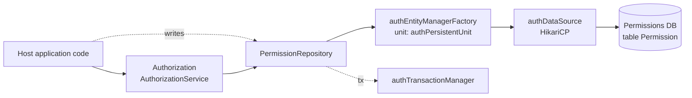

# Authorization — Architecture

## Purpose and scope

**Does**

- Stores permissions as rows of `(subject, action, object, subjectGroup)` and answers existence and
  lookup queries over them. (`domain/Permission.java`, `service/AuthorizationService.java`)
- Partitions permissions by `subjectGroup`, which is `"default"` unless given. Group-aware overloads
  query within one group; calls without a group match across all groups (see [Interfaces](#interfaces)).
 (`Permission.DEFAULT_GROUP`, `Authorization` default methods)
- Auto-configures its own datasource, entity manager factory and transaction manager, isolated from
  the host's persistence unit. They are not default candidates, so the host's own `spring.datasource.*`
  / JPA auto-configuration stays in place. (`config/AuthorizationAutoConfiguration.java`,
  `AuthorizationAutoConfigurationTest`)

**Does not**

- Authenticate users or decide what subjects, actions and objects mean. Those strings come from the
  host.
- Model roles, hierarchies, wildcards or inheritance. A check is an exact match on the tuple.
 (`AuthorizationService#canDo` → `existsBySubjectAndActionAndObject...`)
- Expose HTTP endpoints, publish events or cache results.
- Run schema migrations. Hibernate `hbm2ddl.auto` manages the schema if the host enables it;
  otherwise the host owns the DDL (see [configuration.md](configuration.md#schema)).

## Technical stack

| Item | Value | Evidence |
|---|---|---|
| Java | 21 | `pom.xml` `java.version` |
| Spring Boot | 3.5.14 (`spring-boot-autoconfigure`, `spring-boot-starter-data-jpa`) | `pom.xml` |
| Persistence | Spring Data JPA, Hibernate (`HibernateJpaVendorAdapter`), HikariCP | `AuthorizationAutoConfiguration` |
| Tests | JUnit 5, Spring Boot Test, AssertJ, H2 (test scope) | `pom.xml` |
| Release | `maven-release-plugin`, tags `v<version>` | `pom.xml` |

## Main modules and responsibilities

| Package | Responsibility |
|---|---|
| `config` | `AuthorizationAutoConfiguration`, registered in `META-INF/spring/org.springframework.boot.autoconfigure.AutoConfiguration.imports`. Binds `authorization.datasource*` and `authorization.jpa`. Creates `authDataSource` (Hikari), `authEntityManagerFactory` (persistence unit `authPersistentUnit`, scanning `...authorization.domain`) and `authTransactionManager`, all with `defaultCandidate = false` (wired only by name/qualifier). Enables JPA repositories in `...authorization.repository`. Registers `AuthorizationService` unless the host already provides an `Authorization` bean |
| `domain` | `Permission` entity: generated `id`, `subjectGroup` (default `"default"`), `subject`, `action`, `object`. `equals`/`hashCode` use the four business fields, which have no setters after construction. Unique constraint `uk_permission_tuple` on the four fields, index `idx_permission_action_object` |
| `repository` | `PermissionRepository` (`CrudRepository<Permission, Long>`): finders, `exists...` and `deleteAll...` for every combination of the fields, with and without group. Read-only transactions on `authTransactionManager` by default, read-write for deletes |
| `service` | `Authorization` interface (`canDo`, `whoCan`, `whatCan`, `whereCan`, plus group overloads whose default implementations ignore the group) and the `AuthorizationService` implementation over the repository |

## Interfaces

Java-level only. See [integration.md](integration.md).

| Method | Question answered | Backing query |
|---|---|---|
| `canDo(sub, action, obj[, group])` | Does this exact permission exist? | `existsBySubjectAndActionAndObject[AndSubjectGroup]` |
| `canDo(Permission)` | Same, from an entity. `null` → `false` | default method |
| `whoCan(action, obj[, group])` | Which subjects hold `action` on `obj`? | `findByActionAndObject[AndSubjectGroup]` |
| `whatCan(sub, obj[, group])` | Which actions does `sub` hold on `obj`? | `findBySubjectAndObject[AndSubjectGroup]` |
| `whereCan(sub, action[, group])` | On which objects can `sub` do `action`? | `findBySubjectAndAction[AndSubjectGroup]` |

Without a group argument, `canDo`/`whoCan`/`whatCan`/`whereCan` match **across all groups**, not
just `"default"`. This is the intended contract: hosts check access regardless of group and use the group
to scope grants and revocations. Use the group overloads when a check must stay within one group.
(`AuthorizationService`, `PermissionRepositoryTest#findAllBySubjectAndActionAndObject_returnsAllMatchingGroups`)

## Bean and data layout

## Data and state

| Item | Value |
|---|---|
| Table | One entity, `Permission`. The table and column names follow Hibernate's default physical naming, because the custom entity manager factory doesn't apply Spring Boot's naming strategy |
| Columns | `id`, `subjectGroup`, `subject`, `action`, `object` |
| Keys / constraints | Surrogate `id` (`GenerationType.AUTO`). Unique `uk_permission_tuple (subject, action, object, subjectGroup)`; index `idx_permission_action_object (action, object)` |
| Schema management | `authorization.jpa.properties.hibernate.hbm2ddl.auto` set by the host (`create-drop` in tests), or host-managed DDL |
| Ownership | The host application owns the database instance and its lifecycle |

## Security

See [security-model.md](security-model.md).

## Significant design decisions

- **A separate persistence unit** (`auth*` beans and an `authorization.*` prefix), so the permission
  store can live in its own database, apart from the host's domain data.
- **Overridable service**: `@ConditionalOnMissingBean(Authorization.class)` lets hosts plug in their
  own `Authorization` implementation (commit `9754906`).
- **Group overloads as interface defaults**, so existing custom `Authorization` implementations keep
  compiling (commit `9066fa9`). The defaults ignore the group.
